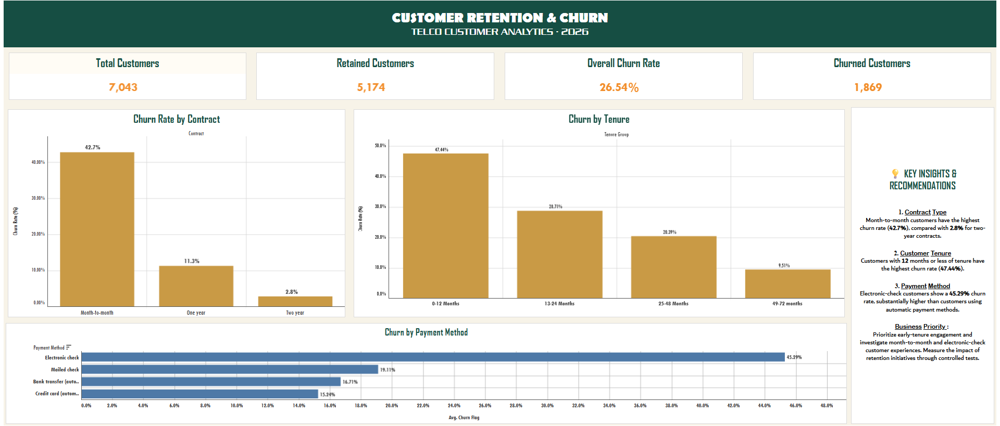

# Customer Retention & Churn Analysis

## 📊 Project Overview

This project analyzes customer churn patterns using the Telco Customer Churn dataset and Tableau Public. The goal is to identify customer segments associated with higher churn and recommend strategies to improve retention.

## 🎯 Objectives

- Analyze overall customer churn and retention.
- Compare churn rates across contract types.
- Understand churn patterns across customer tenure groups.
- Evaluate churn rates by payment method.
- Develop actionable, data-driven retention recommendations.

## 🛠️ Tools Used

- Tableau Public
- Data visualization and exploratory analysis
- Customer segmentation and KPI analysis

## 📈 Key Findings

- **Contract Type:** Month-to-month customers have a churn rate of approximately 42.7%, compared with 2.8% for two-year contracts.
- **Customer Tenure:** Customers with 0–12 months of tenure show the highest churn rate, approximately 47.44%.
- **Payment Method:** Electronic-check customers have a churn rate of approximately 45.29%.

## 💡 Recommendations

- Test loyalty incentives and longer-term contract offers.
- Improve onboarding and early customer engagement.
- Investigate payment-related friction and test convenient automatic-payment options.

## 🖥️ Dashboard

[View the interactive dashboard on Tableau Public](https://public.tableau.com/views/Task-2CustomerRetentionChurnAnalysis/Dashboard1?:language=en-US&publish=yes&:sid=&:redirect=auth&:display_count=n&:origin=viz_share_link)

## 📁 Project Files

- `dashboard.png` — Dashboard preview.
- `Customer_Retention_Churn.twbx` — Packaged Tableau workbook, if included.
- `README.md` — Project documentation.

## 👨‍💻 Author

Abhinav DAs

## 📌 Note

This project was completed as part of the Future Interns Data Science & Analytics Task 2 (2026). Findings describe associations in the dataset and do not establish causation.
